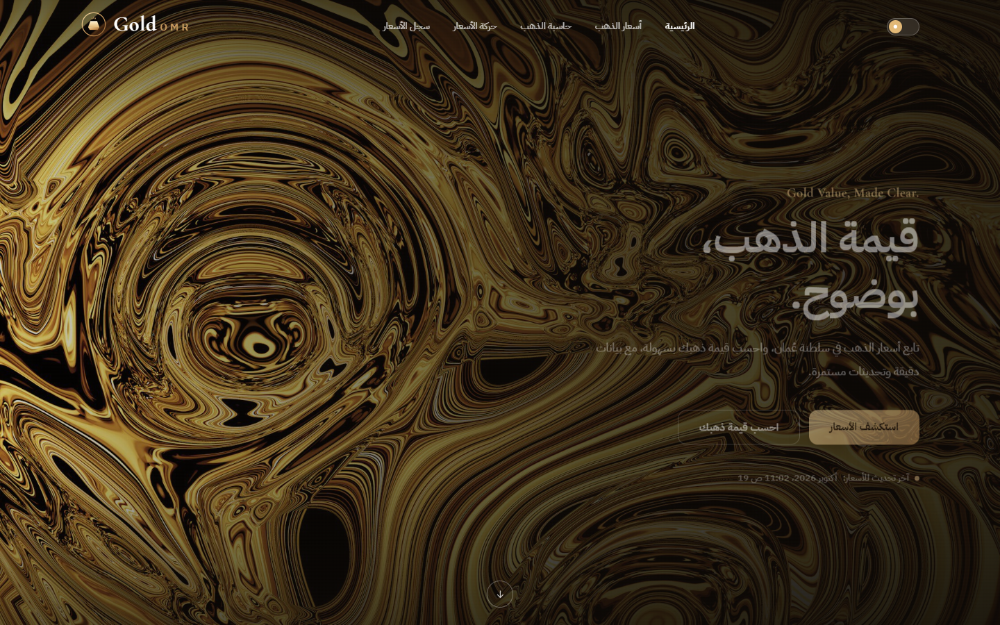
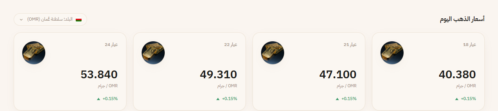
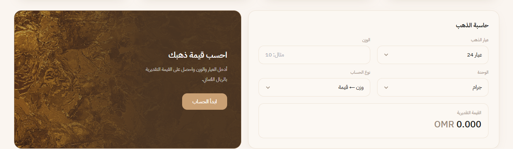
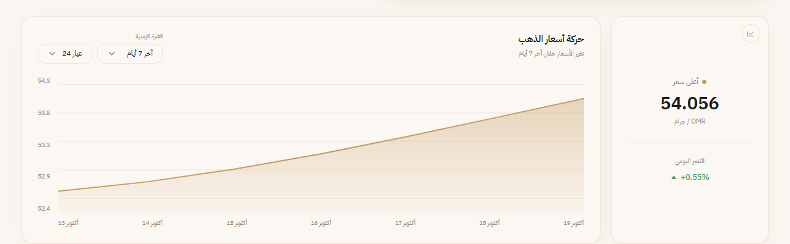
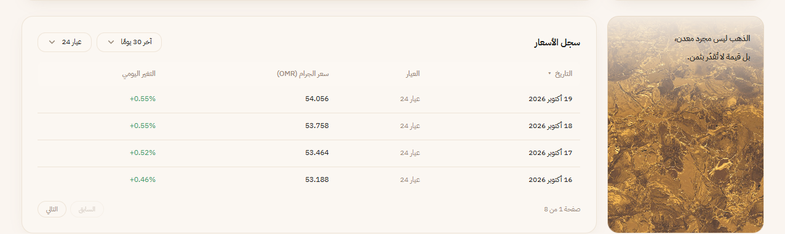
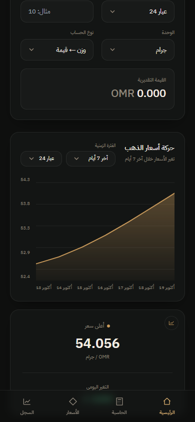
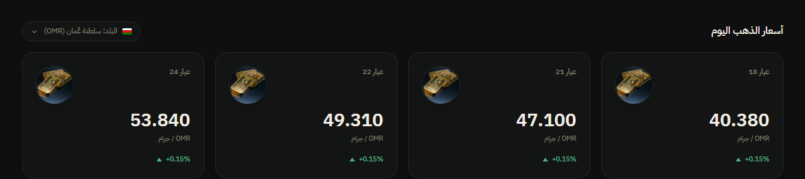
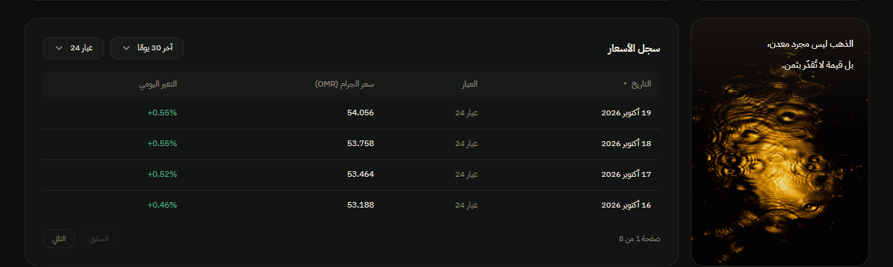

# GoldOMR — متتبع أسعار الذهب في عُمان

مشروع من جزأين يعملان معًا:

| الجزء | التقنية | المجلد | المنفذ |
| --- | --- | --- | --- |
| **Gold Price API** | ASP.NET Core Web API (.NET 10) + Swagger | [`GoldPriceApi/`](GoldPriceApi) | `http://localhost:5000` |
| **واجهة المستخدم** | Angular 16 + Tailwind CSS | [`src/`](src) | `http://localhost:4200` |

كل الأسعار المعروضة في الواجهة تأتي من الـ API عبر `HttpClient`، ولا توجد أي أرقام أسعار ثابتة داخل كود Angular. بيانات الأسعار نفسها تجريبية ومخزّنة في قائمة داخل الخادم (بدون قاعدة بيانات).

---

## 1. المتطلبات

- [.NET SDK 10](https://dotnet.microsoft.com/download)
- [Node.js](https://nodejs.org) (نسخة LTS) مع npm
- متصفح حديث (ويُفضَّل Chrome لتشغيل الاختبارات)

## 2. طريقة التشغيل

افتح **نافذتين** للطرفية من مجلد المشروع.

### النافذة الأولى — الـ API

```powershell
dotnet run --project .\GoldPriceApi\GoldPriceApi.csproj --urls http://localhost:5000
```

- الـ API: `http://localhost:5000/api/goldprices`
- Swagger: `http://localhost:5000/swagger`

### النافذة الثانية — Angular

```powershell
npm install
npm start
```

ثم افتح `http://localhost:4200`.

> الواجهة تتصل بالعنوان `http://localhost:5000/api/goldprices` (معرَّف في [`gold-data.service.ts`](src/app/services/gold-data.service.ts))، وإعداد CORS في الـ API يسمح بالطلبات من `http://localhost:4200` فقط. شغّل الـ API أولًا؛ إن لم يكن يعمل ستظهر في الواجهة رسالة «تعذر تحميل الأسعار».

---

## 3. مسارات الـ API (Endpoints)

الأسعار بالريال العُماني (OMR) لكل جرام. كل الردود بصيغة JSON.

| Method | المسار | الوصف | الحالات |
| --- | --- | --- | --- |
| `GET` | `/api/goldprices` | أسعار جميع العيارات (24 و22 و21 و18) | `200 OK` |
| `GET` | `/api/goldprices/{karat}` | سعر عيار محدد، مثل `/api/goldprices/22` | `200 OK` / `404 Not Found` |
| `GET` | `/api/goldprices?karat=22` | نفس النتيجة عبر Query Parameter (يعيد مصفوفة بعنصر واحد) | `200 OK` / `404 Not Found` |
| `GET` | `/api/goldprices/history` | سجل تجريبي لآخر 30 يومًا لكل العيارات | `200 OK` |

أي Method غير `GET` يعيد `405 Method Not Allowed`.

### أمثلة

```http
GET /api/goldprices
```
```json
[
  { "karat": 24, "pricePerGram": 53.840, "currency": "OMR" },
  { "karat": 22, "pricePerGram": 49.310, "currency": "OMR" },
  { "karat": 21, "pricePerGram": 47.100, "currency": "OMR" },
  { "karat": 18, "pricePerGram": 40.380, "currency": "OMR" }
]
```

```http
GET /api/goldprices/22
```
```json
{ "karat": 22, "pricePerGram": 49.310, "currency": "OMR" }
```

```http
GET /api/goldprices/99        → 404 Not Found
GET /api/goldprices?karat=5   → 404 Not Found
```

```http
GET /api/goldprices/history
```
```json
[
  { "date": "2026-09-20", "k18": 40.380, "k21": 47.100, "k22": 49.310, "k24": 53.840 }
]
```

### تجربة الـ API عبر curl

```bash
curl http://localhost:5000/api/goldprices
curl http://localhost:5000/api/goldprices/24
curl "http://localhost:5000/api/goldprices?karat=21"
curl -i http://localhost:5000/api/goldprices/99     # 404
```

### تجربة الـ API عبر Swagger

1. شغّل الـ API وافتح `http://localhost:5000/swagger`.
2. افتح المسار المطلوب واضغط **Try it out**.
3. أدخل قيمة `karat` (مثل `22`) واضغط **Execute** لترى الرد ورمز الحالة.

---

## 4. هيكل المشروع

```
oman-gold-tracker/
├── GoldPriceApi/                    ← ASP.NET Core Web API
│   ├── Controllers/
│   │   └── GoldPricesController.cs  ← الـ Endpoints وأكواد الحالة (200 / 404)
│   ├── Models/
│   │   └── GoldPrice.cs             ← GoldPrice و HistoricalGoldPrice
│   ├── Services/
│   │   └── GoldPriceService.cs      ← قائمة الأسعار داخل الذاكرة + منطق البحث
│   ├── Program.cs                   ← الإعداد: Controllers, Swagger, CORS, DI
│   └── GoldPriceApi.csproj
├── src/                             ← مشروع Angular
│   ├── app/
│   │   ├── services/gold-data.service.ts   ← الاتصال بالـ API عبر HttpClient
│   │   ├── components/
│   │   │   ├── header/ hero/ price-cards/ price-card/
│   │   │   ├── calculator/ chart/ history-table/
│   │   │   └── footer/ logo/ bottom-nav/
│   │   └── core/theme.service.ts           ← الوضع الفاتح/الداكن
│   ├── assets/images/               ← الصور المحلية (ذهب سائل + سبائك الذهب)
│   └── styles.css                   ← متغيرات الألوان والخطوط
├── docs/screenshots/                ← لقطات الشاشة المستخدمة في هذا الملف
├── tailwind.config.js
└── README.md
```

### كيف يعمل الـ API (باختصار)

- **`GoldPrice`** (نموذج): `Karat` و`PricePerGram` و`Currency`.
- **`GoldPriceService`**: يحتفظ بالأسعار في `List<GoldPrice>` ويوفّر `GetAllPrices()` و`GetPriceByKarat(int)` و`GetHistory()`. مسجَّل كـ `Singleton` في حاوية الاعتماديات (Dependency Injection) ويُحقن في الـ Controller عبر الـ constructor.
- **`GoldPricesController`**: يستقبل الطلبات ويُرجع `Ok(...)` عند وجود البيانات و`NotFound()` عند عدم وجود العيار.
- **`GetHistory()`**: يولّد 30 يومًا تجريبيًا بتقلب بسيط حول السعر الأساسي (دالة جيب) — بيانات للعرض فقط.

---

## 5. أقسام الواجهة (Angular) — ماذا يفعل كل قسم؟

تصميم عربي RTL بهوية ذهبية دافئة، بوضعين: **فاتح** و**داكن**. الصفحة واحدة (Single Page) تتكون من الأقسام التالية من الأعلى إلى الأسفل، وكل قسم مكوّن (Component) مستقل داخل `src/app/components/`.

| # | القسم | المكوّن | يطلب من الـ API |
| --- | --- | --- | --- |
| 1 | الهيدر | `header/` | — |
| 2 | الهيرو (الواجهة الرئيسية) | `hero/` | — |
| 3 | أسعار الذهب اليوم | `price-cards/` + `price-card/` | `GET /api/goldprices` و`/history` |
| 4 | حاسبة الذهب | `calculator/` | `GET /api/goldprices` |
| 5 | حركة أسعار الذهب (الرسم البياني) | `chart/` | `GET /api/goldprices/history` |
| 6 | سجل الأسعار (الجدول) | `history-table/` | `GET /api/goldprices/history` |
| 7 | الفوتر | `footer/` | — |
| 8 | شريط التنقل السفلي (الجوال فقط) | `bottom-nav/` | — |

### 5.1 الهيدر — `header/`
شريط علوي شفاف يظهر فوق صورة الهيرو.
- **الشعار** (`logo/`): سبيكة ذهب داخل حلقة مع اسم GoldOMR، وهو مكوّن قابل لإعادة الاستخدام (يُستخدم أيضًا في الفوتر).
- **روابط التنقل**: الرئيسية، أسعار الذهب، حاسبة الذهب، حركة الأسعار، سجل الأسعار. كل رابط ينقلك بسلاسة إلى القسم المقابل (روابط `#id`).
- **زر الوضع الفاتح/الداكن**: يبدّل مظهر الصفحة كاملة ويحفظ اختيارك في المتصفح (`localStorage`، المفتاح `gold-theme`) فيبقى عند إعادة فتح الصفحة. الوضع الافتراضي فاتح. المنطق في `core/theme.service.ts`.
- يُخفى شريط الروابط على الجوال، ويحل محله شريط التنقل السفلي.

### 5.2 الهيرو — `hero/`


أول ما يراه الزائر: خلفية ذهب سائل بعرض الشاشة كاملة وارتفاعها.
- عنوان «قيمة الذهب، بوضوح.» مع الشعار الإنجليزي Gold Value, Made Clear.
- زر **استكشف الأسعار** ينقل إلى قسم الأسعار، وزر **احسب قيمة ذهبك** ينقل إلى الحاسبة.
- سطر **آخر تحديث للأسعار** بتاريخ ووقت فتح الصفحة (يُحسب في المتصفح).
- سهم في الأسفل للنزول إلى الأسعار. على الجوال يأخذ الهيرو ارتفاعًا أدنى بدل ملء الشاشة.

### 5.3 أسعار الذهب اليوم — `price-cards/` و`price-card/`


أربع بطاقات، واحدة لكل عيار (18 و21 و22 و24) بترتيب تصاعدي.
- تعرض **سعر الجرام بالريال العُماني** المأخوذ من `GET /api/goldprices`.
- تعرض **نسبة التغير اليومي**: تُحسب بمقارنة السعر الحالي بسعر اليوم السابق من `GET /api/goldprices/history`. سهم أخضر للأعلى وأحمر للأدنى.
- أيقونة سبيكة ذهبية لكل بطاقة. زر «البلد: سلطنة عُمان» للعرض فقط.
- على الجوال تصبح البطاقات شريطًا أفقيًا تتحرك فيه بالسحب.
- إن فشل الاتصال بالـ API تظهر رسالة «تعذر تحميل الأسعار».

### 5.4 حاسبة الذهب — `calculator/`


يتكون من بطاقتين: بطاقة ترويجية «احسب قيمة ذهبك» (زرها **ابدأ الحساب** ينقل المؤشر إلى حقل الإدخال)، وبطاقة الحاسبة نفسها.
- **عيار الذهب**: 18 / 21 / 22 / 24، ويُستخدم سعر العيار المختار من الـ API.
- **نوع الحساب**: «وزن ← قيمة» (تُدخل الوزن فتحصل على القيمة بالريال)، أو «مبلغ ← وزن» (تُدخل المبلغ فتحصل على الوزن).
- **الوحدة**: جرام أو أونصة (الأونصة = 31.1034768 جرام).
- النتيجة **تُحسب فورًا أثناء الكتابة** بدون زر، وتظهر `OMR 0.000` حتى تُدخل قيمة صحيحة.

### 5.5 حركة أسعار الذهب — `chart/`


رسم بياني مساحي (SVG مرسوم يدويًا بدون مكتبات) لحركة سعر عيار واحد.
- **الفترة الزمنية**: آخر 7 أو 14 أو 30 يومًا.
- **العيار**: يمكن تغييره من القائمة.
- محور رأسي بالأسعار ومحور أفقي بالتواريخ. عند تمرير الفأرة على الرسم يظهر **خط ونقطة ونافذة** بالتاريخ والسعر لتلك النقطة.
- **البطاقة الجانبية**: أعلى سعر خلال الفترة المختارة، والتغير اليومي بالنسبة المئوية.

### 5.6 سجل الأسعار — `history-table/`


جدول يعرض الأسعار اليومية السابقة.
- أعمدة: **التاريخ** والعيار وسعر الجرام والتغير اليومي (ملوّن بالأخضر أو الأحمر).
- **فلترة** بالعيار والفترة (7 / 14 / 30 يومًا).
- النقر على عنوان «التاريخ» **يعكس الترتيب** (الأحدث أولًا أو الأقدم أولًا).
- **ترقيم صفحات** بأربعة صفوف في كل صفحة، مع أزرار السابق/التالي.
- بجوار الجدول بطاقة اقتباس زخرفية («الذهب ليس مجرد معدن...»)، وتُخفى على الجوال.

### 5.7 الفوتر — `footer/`
الشعار وسطر حقوق النشر مع التنبيه بأن البيانات تجريبية.

### 5.8 شريط التنقل السفلي — `bottom-nav/`


يظهر **على الجوال فقط** ثابتًا أسفل الشاشة بأربعة روابط: الرئيسية، الحاسبة، الأسعار، السجل.

### الوضع الداكن

نفس الأقسام بألوان داكنة:





### 5.9 الخدمات المشتركة
| الملف | وظيفته |
| --- | --- |
| `services/gold-data.service.ts` | الوحيد الذي يتصل بالـ API (`getCurrentPrices` و`getPriceByKarat` و`get30DayHistory`) |
| `core/theme.service.ts` | تبديل الوضع الفاتح/الداكن وحفظه |
| `styles.css` | متغيرات الألوان للوضعين، والخطوط (IBM Plex Sans Arabic وCormorant Garamond)، وتكبير الحجم تلقائيًا على شاشات اللابتوب |

> يوجد في المشروع مكوّنات قديمة (التنبيهات، الإعدادات، القائمة الجانبية) غير مستخدمة في الصفحة الحالية.

---

## 6. البناء والاختبارات

```powershell
dotnet build .\GoldPriceApi\GoldPriceApi.csproj     # بناء الـ API
npm run build                                       # بناء Angular (الناتج في dist/)
npm test -- --watch=false --browsers=ChromeHeadless # اختبارات Angular (19 اختبارًا)
```

## 7. قائمة التحقق من متطلبات التسليم

- [x] ASP.NET Core Web API باستخدام **Controllers**
- [x] عرض أسعار **جميع العيارات** — `GET /api/goldprices`
- [x] عرض سعر **عيار محدد** — `GET /api/goldprices/{karat}` أو `?karat=`
- [x] الأسعار في **قائمة داخل التطبيق** بدون قاعدة بيانات
- [x] **HTTP Methods** مناسبة (`GET`) و**Status Codes** (`200` و`404`)
- [x] **Swagger** على `/swagger`
- [x] كود منظَّم في مجلدات (Controllers / Models / Services) وبرمجة كائنية (OOP)
- [x] **ربط Angular بالـ API** — كل الأسعار تُجلب من الـ API
- [x] README يشرح التشغيل والـ Endpoints

---

> ملاحظة: الأسعار تجريبية للعرض فقط وليست أسعارًا حيّة من السوق.

## 8. مصادر الصور

كل الصور محفوظة محليًا في `src/assets/images/` ولا تُحمَّل من الإنترنت أثناء التشغيل. مصدرها مواقع الصور المجانية (Unsplash وPexels) وتُستخدم وفق رخصها المجانية:
- `gold-swirl.jpg` و`gold-molten.jpg`: Unsplash (ذهب سائل ومصهور)
- `gold-ripples.jpg` و`gold-bars.jpg`: Pexels (تموجات ذهبية وسبائك ذهب)
